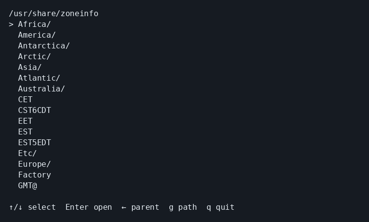

# FolderWalk demo

This example browses the public time-zone database shipped with Linux.
The screenshots show a 72-column, 19-row terminal. They were rendered as
PNGs from the real FolderWalk application's terminal output captured in a
Linux pseudo-terminal.

From the project checkout, run:

```sh
cargo build --locked
folderwalk="$PWD/target/debug/folderwalk"
(cd /usr/share/zoneinfo && "$folderwalk")
```

## Startup

The first row displays the full current path. The entries below it are
sorted by name. The greater-than sign marks the selection.



## Open a directory

Select Africa with the arrow keys if necessary and press Enter. The full
path and listing change to show that directory.


## Edit a path

Press g and type `../Europe` without pressing Enter. The Africa path and its
listing stay on screen while the path appears in the editor. Press Enter
to open Europe, or Escape to stay in Africa. Press q to quit browsing.


