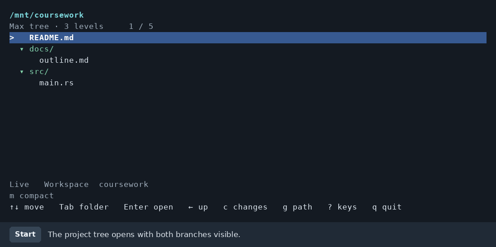
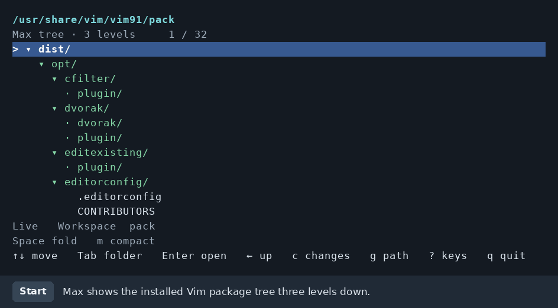
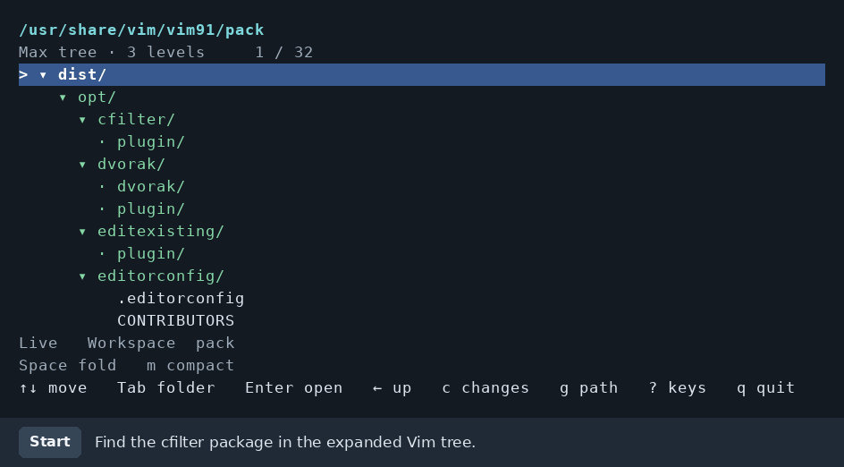
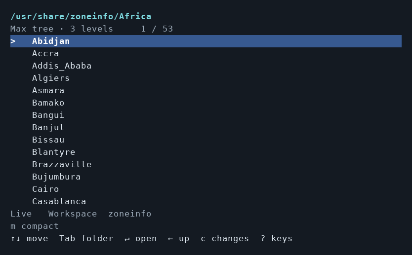
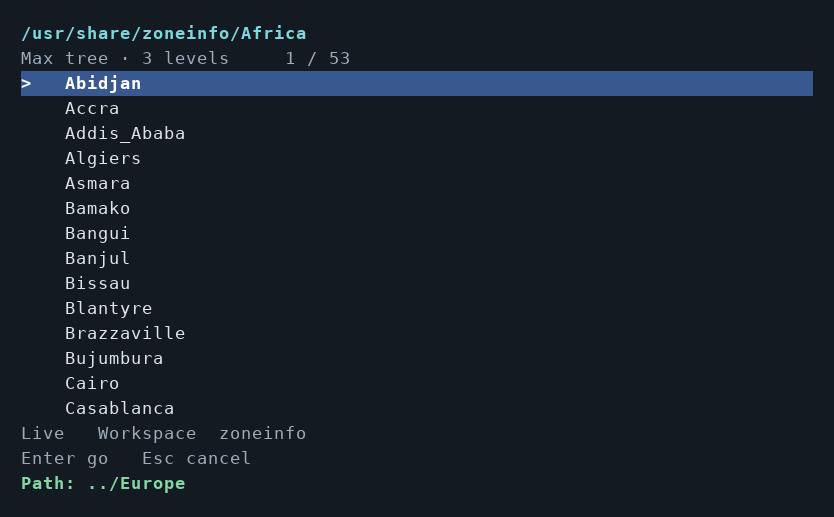

# FolderWalk demo

## Notice a save while browsing another folder

This recording opens a small course project with `docs/` and `src/` visible.
Tab jumps between the folders, and Enter opens `src/`. A second process then
writes to `docs/outline.md`. Watch for the change notice before the next keypress.
Press c for recent changes and Enter on the edited file to reveal it in `docs/`.
Press the minus key to return to your place in `src/`.



[Download the terminal recording](demo-images/live-folder-travel.cast)

To try it yourself, run the following commands from the FolderWalk checkout in
a terminal. Keep the example directory open in a second terminal.

```sh
cargo build --locked
folderwalk="$PWD/target/debug/folderwalk"
mkdir -p .scratch
project=$(mktemp -d "$PWD/.scratch/coursework.XXXXXX")
mkdir "$project/docs" "$project/src"
touch "$project/docs/outline.md" "$project/src/main.rs" "$project/README.md"
echo "$project"
(cd "$project" && FOLDERWALK_THEME=mixed "$folderwalk")
```

Open `src/` in FolderWalk. In the second terminal, change to the printed
directory and append a line to the document.

```sh
printf '\nRevised outline\n' >> docs/outline.md
```

## Fold and reopen a branch

These examples browse the installed Vim packages on Linux. From the checkout
with the binary path set as above, run the following command.

```sh
(cd /usr/share/vim/vim91/pack && FOLDERWALK_THEME=mixed "$folderwalk")
```

Max view initially shows `dist/`, its `opt/` directory, packages such as
`cfilter/`, and the `plugin/` directory inside that package. Press Space on
`dist/` to fold it. Press Space again to see its descendants in place.



[Download the terminal recording](demo-images/expand-and-collapse.cast)

## Open a folder at the limit

In Max view, press Down three times to select `cfilter/plugin/`. Press
Enter to open the directory and see `cfilter.vim`.



[Download the terminal recording](demo-images/open-at-limit.cast)

The GIF captions identify the input or external action for each frame. The
asciicast files contain the sessions’ timed terminal output. To replay one,
run `asciinema play live-folder-travel.cast` with the downloaded file.

## Browse and edit a path

The following examples use the Linux time-zone database.

```sh
(cd /usr/share/zoneinfo && "$folderwalk")
```

Select `Africa/` and press Enter to open it.




Press g and type `../Europe`. The Africa listing stays visible while you edit.
Press Enter to open Europe, Escape to cancel the edit, or q to quit browsing.


